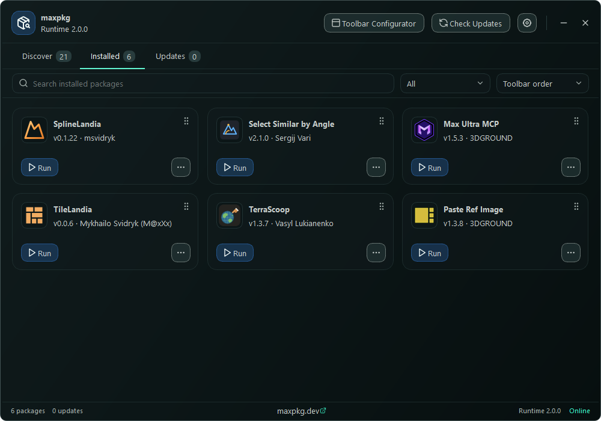

# MaxPkg Package Manager

## All your 3ds Max scripts in one place

You know the drill: you find a cool script, download some archive, wonder where it goes, copy it somewhere,
and a month later you have no idea what is installed or which version it is.

MaxPkg fixes that. Think of it as an app store for 3ds Max. Open it, find a script, click `Install`, use it.
That's it.

## Install it

1. Download **[MaxPkg-Runtime-Manager-Qt.mzp](https://github.com/maxpkg-dev/MaxPkg-Runtime-Manager-Qt/releases/latest/download/MaxPkg-Runtime-Manager-Qt.mzp)**.
2. Drag the file into a 3ds Max viewport.

Done. Everything else happens by itself, and a welcome window shows you around.

Drag and drop didn't work? In 3ds Max go to `Scripting > Run Script...` and pick the same file.

Already found a script on [maxpkg.dev](https://maxpkg.dev)? Even easier: click `Install` on its page and drag the
block from the website into a viewport. You get the script, and MaxPkg too if you don't have it yet.

**You need** 3ds Max 2022 or newer, and internet when you look for, install or update scripts. Scripts you already
installed keep working offline. On an older 3ds Max, use the
[previous MaxPkg](https://github.com/maxpkg-dev/MaxPkg-Runtime-Manager).

## What you can do

**Find scripts.** Look through the catalog by category, collection or just by typing a name. Every script has its
description, screenshots, videos and a list of what changed in each version.

**Install in one click.** No folders, no copying files. The script appears on your toolbar and it's ready to go.
Arranged a favourite collection as a toolbar on maxpkg.dev? `Install all scripts` sets up your MaxPkg toolbar the same
way: the same order, the same dividers.

**Keep your favourites close.** The MaxPkg toolbar holds your scripts. Dock it to any side of the screen or let it
float, choose big or small buttons, drag them around, hide the ones you don't need.

**Stay up to date.** `Check Updates` shows what has a new version, and one click updates it, or all of them at once.
You can also let it do this on its own. MaxPkg updates itself too, so there is nothing to download again.

**Clean up.** Don't need a script any more? Click `Uninstall` and it's gone, buttons included. Your scenes stay as they are.

## Where to find it

Click the MaxPkg button on the toolbar. Toolbar hidden? Press `X` in 3ds Max and type `MaxPkg Manager`.

## Is it safe?

Scripts on maxpkg.dev are reviewed before they are published. When a version comes with a published fingerprint,
MaxPkg compares it with the file it downloaded. If they don't match, the file gets deleted and nothing is installed.

## Something went wrong?

1. Click `View Logs` at the bottom left of the window to see what happened.
2. Restart 3ds Max.
3. Still stuck? [Tell us about it](https://github.com/maxpkg-dev/MaxPkg-Runtime-Manager-Qt/issues). Mention your
   3ds Max version, the MaxPkg version from the bottom of the window, and what you were doing.

## Want to remove MaxPkg?

Open `Settings > Uninstall`. No hard feelings.

## Links

- Browse scripts: [maxpkg.dev](https://maxpkg.dev)
- Made by [3DGROUND](https://3dground.net)

## License

MaxPkg Package Manager is provided only for use with the official MaxPkg service. Unauthorized copying, modification,
redistribution, reverse engineering, or use with third-party installer endpoints is prohibited.

Copyright (c) 2026 Lukianenko Vasyl.
