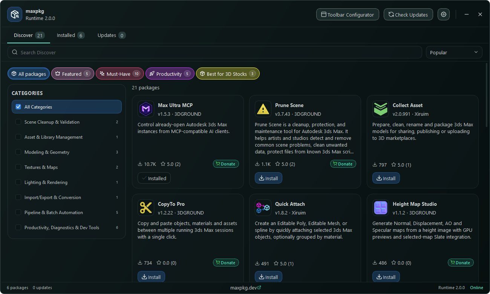

# MaxPkg Package Manager

Package manager for Autodesk 3ds Max, rebuilt on **Python + Qt**: find scripts in the
[maxpkg.dev](https://maxpkg.dev) catalog, install, run, update and remove them, and keep your favourite
tools on the MaxPkg toolbar. Same Manager you know — without the embedded web browser.



## Why it was rebuilt

The previous MaxScript version renders its UI in a dotNet `WebBrowser` and runs parts of its update logic in
background threads, which can end in *"MAXScript Garbage Collection Error"* and freezes while the
catalog loads. This version uses the Qt and Python that ship with 3ds Max:

- no WebBrowser, no dotNet; all network work in background threads, MaxScript only on the main thread;
- the window stays responsive while the catalog, details and images load;
- a native 3ds Max toolbar that docks to any edge or floats.

## Run (preview)

In 3ds Max: *Scripting → Run Script…* → `StartMaxPkg.ms`, or in the Listener:

```maxscript
fileIn @"<repository folder>\StartMaxPkg.ms"
```

Running it again restarts the Package Manager cleanly. The preview runs beside the previous MaxScript version and imports
its settings on first start (`settings.ini`, same format).

## The Manager

- **Discover** — catalog with collections, categories (side panel on wide windows, dropdown on narrow
  ones), sorting, 24 packages per page.
- **Installed / Updates** — compact or full cards, filters, sorting, drag the grip to reorder the toolbar.
- **Details** — description, screenshots (click for full window), changelog, package information, links.
- **Settings** — separate floating window: General, Updates, Toolbar (live preview), Themes, Developer,
  About.
- Own rounded window: drag the header, double-click to maximise, `–` collapses it to a small bar
  (click its name to open again). Place, size and state are remembered.
- Keys: `Ctrl+F` search, `Esc` back/clear, `F5` refresh, `Ctrl+1/2/3` tabs, `Ctrl+,` Settings.

## The toolbar

Top, bottom, left, right or floating; icon size, spacing, button style and second line (version or
developer) are set in Settings → Toolbar. Buttons that do not fit go into the `»` menu. Hold **Alt** and
drag to reorder; right-click for Run, Details, Update, Move, Hide and toolbar options.

## Compatibility

| 3ds Max | Python | Qt | Status |
|---|---|---|---|
| 2027 | 3.13 | PySide6 6.8 | tested |
| 2025–2026 | 3.11 | PySide6 | targeted, not tested yet |
| 2022–2024 | 3.7–3.10 | PySide2 | targeted, not tested yet |

## Status

Preview 2.0.0. Done: Manager (Discover, Installed, Updates, Details, Settings), toolbar, themes, update
check, install/update/uninstall logic. Not done yet: onboarding window, Runtime self-update, removing the
Runtime from Settings, the MaxScript `MaxPkg` facade for package installers and the website, MZP package,
tests on PySide2. Install/uninstall code is ported from the MaxScript Runtime but has not been exercised
on a real profile yet.

## Repository

| Path | |
|---|---|
| `StartMaxPkg.ms`, `python/bootstrap.py` | launcher and clean restart |
| `python/maxpkg_runtime/` | `domain/` (pure), `services/`, `ui/` |
| `assets/` | Lucide icons, themes, `manager.qss` |
| `tests/` | unit tests and in-Max scripts |
| `docs/` | architecture, UI, original spec, screenshots |
| `.agents/`, `.claude/CLAUDE.md` | rules for contributors and agents, pitfalls (`.agents/pitfalls.md`) |

## License

MaxPkg Package Manager is provided only for use with the official MaxPkg service. Unauthorized copying,
modification, redistribution, reverse engineering, or use with third-party installer endpoints is
prohibited. Copyright (c) 2026 Lukianenko Vasyl. Developed by [3DGROUND](https://3dground.net).
